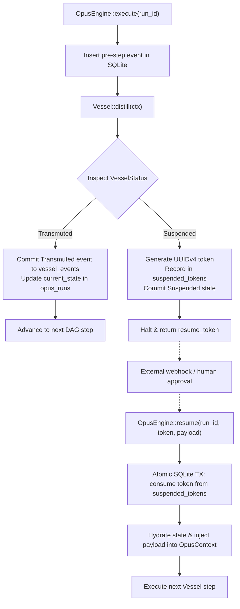

# Durable State Architect (Crucible & Opus Persistence Guide)

A specialized skill for designing and auditing durable workflow execution, event-sourced state machines, SQLite WAL concurrency, and tokenized pause/resume semantics in **`rubedo-opus`** and **`rubedo-crucible`**.

---

## 🎯 Core Durability Invariants

1. **Deterministic Checkpointing**:
   - Execution state must be persisted to SQLite *before* and *after* each Vessel step.
   - If an Opus run is halted midway (crash, reboot, power failure), `CrucibleEngine` can hydrate state from the latest recorded checkpoint and resume execution.

2. **Unforgeable Single-Use Resume Tokens**:
   - Suspending nodes (`VesselStatus::Suspended { resume_token }`) must generate cryptographically secure UUIDv4 tokens.
   - Resuming execution (`OpusEngine::resume(run_id, token, payload)`) MUST atomically validate and delete the token from `suspended_tokens` inside a SQLite transaction to prevent double-resumption replay attacks.

3. **High-Concurrency SQLite WAL Mode**:
   - Connection pools in `rubedo-crucible` must enable Write-Ahead Logging:
     ```sql
     PRAGMA journal_mode = WAL;
     PRAGMA synchronous = NORMAL;
     PRAGMA busy_timeout = 5000;
     ```

---

## 🔄 State Machine & Execution Flow



---

## 📋 Technical References
- [Crucible Database Schema](./references/crucible_schema.md) — DDL statements, tables (`opus_runs`, `vessel_events`, `suspended_tokens`), and indexes.
- [Event Sourcing Patterns](./references/event_sourcing_patterns.md) — Hydration, append-only logs, and replay patterns.
- Helper Script: `inspect_crucible_db.ps1`
