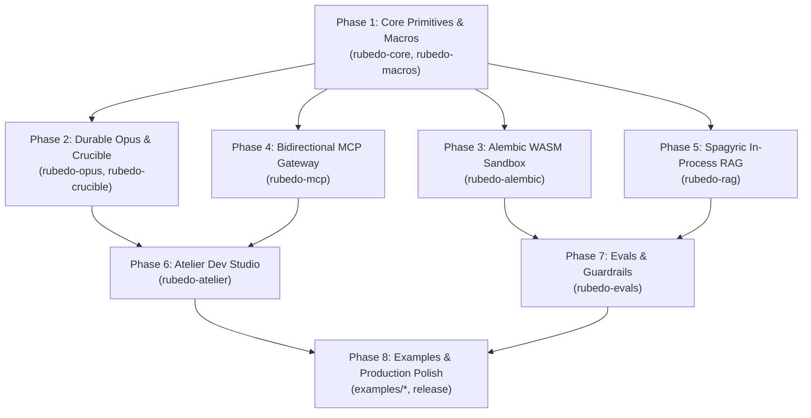

# RUBEDO: Master Phased Implementation Plan

This document serves as the master execution roadmap for building the **Rubedo** agentic framework in Rust. Each phase is decomposed into sequential, verifiable subtasks with explicit verification tests and commands.

---

## Architecture Dependency Flow



---

## Master Phase Checklist

- [x] **Phase 1: Foundation & `#[reagent]` Macro Synthesizer**
  - [x] 1.1 Root Cargo Workspace initialization (`Cargo.toml`)
  - [x] 1.2 `rubedo-core` crate scaffolding (`Cargo.toml`, `src/lib.rs`)
  - [x] 1.3 `Reagent` trait & `ReagentError` error model implementation
  - [x] 1.4 `Artificer` struct, `Envelope`, and `AthanorContext` execution memory
  - [x] 1.5 `rubedo-macros` crate scaffolding (`Cargo.toml`, `src/lib.rs`)
  - [x] 1.6 `#[reagent]` proc-macro: AST parsing (`syn::ItemFn`), doc extraction, schema generation (`schemars`), and code emission
  - [x] 1.7 Phase 1 Unit and Integration Test Suite
  - [x] 1.8 Verify Phase 1: `cargo test -p rubedo-core -p rubedo-macros`

- [x] **Phase 2: Durable Opus & Crucible Persistence**
  - [x] 2.1 `rubedo-crucible` crate scaffolding with `sqlx` (SQLite)
  - [x] 2.2 Embedded SQLite migrations (`01_init.sql`: `opus_runs`, `vessel_events`, `suspended_tokens`)
  - [x] 2.3 `CrucibleEngine` implementation (run state persistence, transition logging, checkpointing)
  - [x] 2.4 `rubedo-opus` crate scaffolding (`Cargo.toml`, `src/lib.rs`)
  - [x] 2.5 `Vessel` trait, `VesselStatus`, and `VesselError` models
  - [x] 2.6 `OpusBuilder` and DAG topology execution loop
  - [x] 2.7 Suspension state machine: `VesselStatus::Suspended { resume_token }`
  - [x] 2.8 Resumption engine: `OpusEngine::resume(run_id, token, payload)`
  - [x] 2.9 Phase 2 Integration Test (3-step workflow suspension & resumption)
  - [x] 2.10 Verify Phase 2: `cargo test -p rubedo-crucible -p rubedo-opus`

- [x] **Phase 3: Alembic WASM Sandbox Runtime**
  - [x] 3.1 `rubedo-alembic` crate scaffolding with `wasmtime` and `wasmtime-wasi`
  - [x] 3.2 `AlembicConfig` definition (`max_memory_bytes`, `fuel_limit`)
  - [x] 3.3 `AlembicSandbox` engine initialization with fuel metering enabled
  - [x] 3.4 Host-guest linear memory bridge (JSON payload exchange protocol)
  - [x] 3.5 Dynamic `WasmReagent` wrapper implementing `rubedo_core::Reagent`
  - [x] 3.6 Fuel exhaustion & memory limit abort handling
  - [x] 3.7 Phase 3 Test: Infinite loop execution halted in $<15$ ms
  - [x] 3.8 Verify Phase 3: `cargo test -p rubedo-alembic`

- [ ] **Phase 4: Bidirectional Model Context Protocol (MCP) Gateway**
  - [ ] 4.1 `rubedo-mcp` crate scaffolding with JSON-RPC 2.0 primitives
  - [ ] 4.2 Transport abstractions: stdio and Server-Sent Events (SSE)
  - [ ] 4.3 `McpClient` implementation: tool discovery (`tools/list`) and dynamic `Reagent` synthesis
  - [ ] 4.4 `McpServer` implementation: native Reagent registry exposure and `tools/call` invocation handler
  - [ ] 4.5 Phase 4 In-Memory Duplex Test: McpServer exposes native tool, McpClient discovers & executes it
  - [ ] 4.6 Verify Phase 4: `cargo test -p rubedo-mcp`

- [ ] **Phase 5: Spagyric In-Process Vector Store (RAG)**
  - [ ] 5.1 `rubedo-rag` crate scaffolding with `fastembed` and `lancedb`
  - [ ] 5.2 Document splitters: semantic and recursive text chunking
  - [ ] 5.3 `SpagyricIndex` implementation with automatic local embedding initialization (`BGESmallENV15`)
  - [ ] 5.4 Document ingestion (`add_documents`) and vector search (`search`)
  - [ ] 5.5 Dynamic `SearchReagent` generation for Artificers
  - [ ] 5.6 Phase 5 Semantic Test: synonym query matches target document with cosine similarity $>0.70$
  - [ ] 5.7 Verify Phase 5: `cargo test -p rubedo-rag`

- [ ] **Phase 6: Atelier Dev Studio & Observability Server**
  - [ ] 6.1 `rubedo-atelier` crate scaffolding with `axum`, `tower-http`, and `rust-embed`
  - [ ] 6.2 Telemetry pipeline: custom `tracing_subscriber::Layer` feeding Tokio broadcast channel
  - [ ] 6.3 HTTP API endpoints (`GET /api/registry`, `GET /api/events` SSE, `POST /api/opus/:run_id/resume`)
  - [ ] 6.4 Static asset handler (`GET /*`) serving embedded Svelte UI from memory
  - [ ] 6.5 Svelte/Vite UI minimal visualizer shell for live traces and checkpoint inspection
  - [ ] 6.6 Phase 6 Integration Test: Ephemeral server start & registry endpoint validation
  - [ ] 6.7 Verify Phase 6: `cargo test -p rubedo-atelier`

- [ ] **Phase 7: Verification Harness & Evaluation Guardrails**
  - [ ] 7.1 `rubedo-evals` crate scaffolding
  - [ ] 7.2 Deterministic scoring metrics: `ExactMatch`, `LevenshteinDistance`, `JsonGrammarValidator`
  - [ ] 7.3 Model-graded scoring harness: `LlmJudge` (factual correctness, toxicity, tone)
  - [ ] 7.4 `#[artificer_test]` procedural macro for benchmark runner
  - [ ] 7.5 Phase 7 Verification Test: simulated failure conditions return non-zero exit codes below threshold
  - [ ] 7.6 Verify Phase 7: `cargo test -p rubedo-evals`

- [ ] **Phase 8: Reference Examples & Showcase Applications**
  - [ ] 8.1 Example 1: `basic-artificer` (ReAct agent reasoning with custom Reagents)
  - [ ] 8.2 Example 2: `durable-transmutation` (Multi-step suspended workflow resumed via token)
  - [ ] 8.3 Example 3: `sandboxed-alembic` (Executing untrusted WASM under fuel and memory limits)
  - [ ] 8.4 Full workspace build and test run: `cargo test --all`

---

## Detailed Phase Specifications

### Phase 1: Foundation & `#[reagent]` Macro Synthesizer
- **Primary Target Crates**: `crates/rubedo-core`, `crates/rubedo-macros`
- **Specification**: [Detailed Phase 1 Guide](file:///c:/dev/Rubedo/docs/phases/phase-01-core-and-macros.md)
- **Exit Criteria**: `#[reagent]` generates valid JSON schemas; `transmute()` correctly validates inputs against schema; zero lifetime annotations required.
- **Verification Command**:
  ```bash
  cargo test -p rubedo-core -p rubedo-macros
  ```

### Phase 2: Durable Opus & Crucible Persistence
- **Primary Target Crates**: `crates/rubedo-opus`, `crates/rubedo-crucible`
- **Specification**: [Detailed Phase 2 Guide](file:///c:/dev/Rubedo/docs/phases/phase-02-opus-and-crucible.md)
- **Exit Criteria**: Workflows can halt at any step, persist state to SQLite, yield a token, and cleanly resume from token without state corruption.
- **Verification Command**:
  ```bash
  cargo test -p rubedo-crucible -p rubedo-opus
  ```

### Phase 3: Alembic WASM Sandbox Runtime
- **Primary Target Crates**: `crates/rubedo-alembic`
- **Specification**: [Detailed Phase 3 Guide](file:///c:/dev/Rubedo/docs/phases/phase-03-alembic-wasm.md)
- **Exit Criteria**: Untrusted guest WASM modules run with zero filesystem/network access; infinite loops abort within 15ms upon fuel exhaustion.
- **Verification Command**:
  ```bash
  cargo test -p rubedo-alembic
  ```

### Phase 4: Bidirectional Model Context Protocol (MCP) Gateway
- **Primary Target Crates**: `crates/rubedo-mcp`
- **Specification**: [Detailed Phase 4 Guide](file:///c:/dev/Rubedo/docs/phases/phase-04-mcp-gateway.md)
- **Exit Criteria**: Internal reagents can be served over MCP stdio/SSE; external MCP servers can be consumed seamlessly as dynamic `dyn Reagent` instances.
- **Verification Command**:
  ```bash
  cargo test -p rubedo-mcp
  ```

### Phase 5: Spagyric RAG & In-Process Vector Store
- **Primary Target Crates**: `crates/rubedo-rag`
- **Specification**: [Detailed Phase 5 Guide](file:///c:/dev/Rubedo/docs/phases/phase-05-spagyric-rag.md)
- **Exit Criteria**: Documents split, embedded via `fastembed-rs` (BGESmallENV15), stored in `lancedb`, and queried with cosine similarity $>0.70$ completely in-process.
- **Verification Command**:
  ```bash
  cargo test -p rubedo-rag
  ```

### Phase 6: Atelier Dev Studio & Observability Server
- **Primary Target Crates**: `crates/rubedo-atelier`
- **Specification**: [Detailed Phase 6 Guide](file:///c:/dev/Rubedo/docs/phases/phase-06-atelier-studio.md)
- **Exit Criteria**: Embedded Axum server starts, serves static frontend assets via `rust-embed`, streams live SSE telemetry, and exposes checkpoint replay API.
- **Verification Command**:
  ```bash
  cargo test -p rubedo-atelier
  ```

### Phase 7: Verification Harness & Evaluation Guardrails
- **Primary Target Crates**: `crates/rubedo-evals`
- **Specification**: [Detailed Phase 7 Guide](file:///c:/dev/Rubedo/docs/phases/phase-07-evals-and-guardrails.md)
- **Exit Criteria**: Automated benchmark evaluation suite detects regressions, scores semantic criteria, and enforces token budgets.
- **Verification Command**:
  ```bash
  cargo test -p rubedo-evals
  ```

### Phase 8: Reference Examples & Workspace Release
- **Primary Target**: `examples/*` and root workspace validation
- **Specification**: [Detailed Phase 8 Guide](file:///c:/dev/Rubedo/docs/phases/phase-08-examples-and-release.md)
- **Exit Criteria**: All three reference examples build and run without warnings; `cargo test --all` passes 100%.
- **Verification Command**:
  ```bash
  cargo test --all
  ```

---

## Strict Implementation Constraints

1. **Zero Lifetime Annotations**: All types passing through `Opus`, `Reagent`, and `Artificer` must be `'static + Send + Sync`. Autonomous authoring agents must never be required to specify lifetime parameters (`<'a>`).
2. **Error Handling Integrity**: Use `thiserror` for all error declarations. Explicitly forbid `unwrap()` and `expect()` in non-test code paths.
3. **Workspace Dependency Alignment**: Keep all external crate versions pinned and aligned with root `Cargo.toml`.
4. **Async Trait Standard**: Ensure all asynchronous traits use `#[async_trait]`.
5. **Memory Envelope**: Maintain strict adherence to sub-40MB resident memory footprint for baseline runtime.
