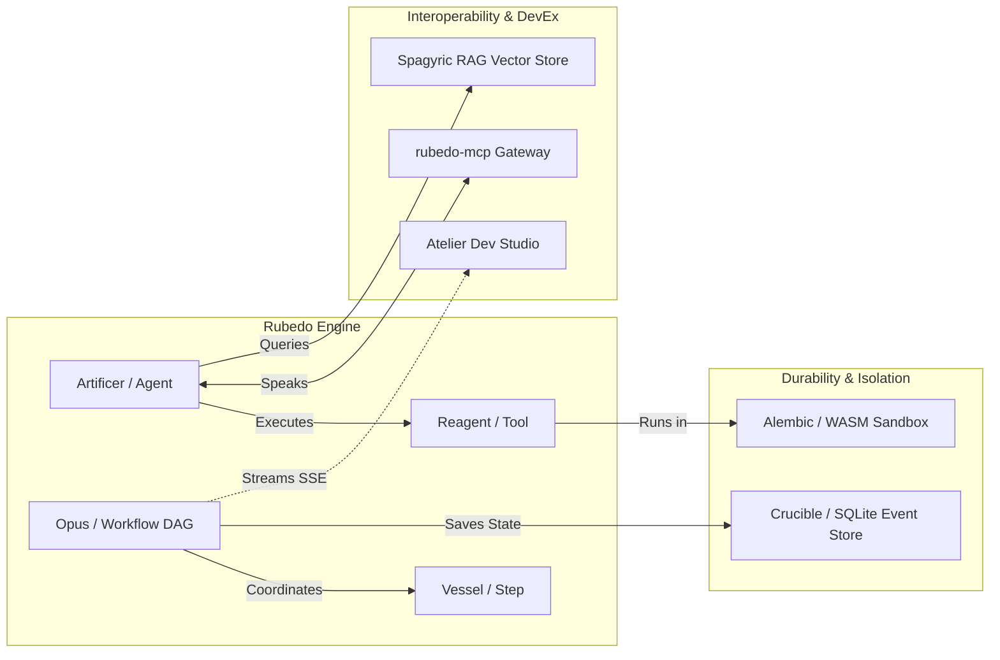

# RUBEDO: Product Plan & Strategic Roadmap

## Executive Summary

**Rubedo** is an ironclad, enterprise-grade agentic framework engineered in Rust. Named after the fourth and final alchemical phase (*rubedo*, redness)—wherein base matter is transmuted into enduring gold—Rubedo distills chaotic, non-deterministic LLM streams into deterministic, verified, and durable state transitions.

While the modern AI landscape is inundated with dynamic, interpreted Python agent frameworks (e.g., LangChain, AutoGen, CrewAI), production engineering teams face severe hurdles: runtime type mismatches, uncontrolled memory growth, lack of deterministic execution checkpointing, cumbersome infrastructure requirements (external Redis/Postgres/Vector databases), and hazardous untrusted code execution.

Rubedo establishes a new paradigm: **zero external infrastructure**, **sub-40MB resident memory footprint**, **deterministic SQLite-backed pause/resume workflows**, **fuel-metered WASM tool isolation**, and **bidirectional Model Context Protocol (MCP)** integration.

---

## 1. Problem Statement & Market Opportunity

### 1.1 The Production Agent Dilemma

| Challenge in Existing Frameworks | Python Ecosystem (LangChain, AutoGen, CrewAI) | Typical Rust Attempts (Rig, raw LLM APIs) | Rubedo Solution |
|:---|:---|:---|:---|
| **Type Safety & Schema Integrity** | Dynamic schemas prone to runtime `KeyError` or malformed LLM JSON. | Requires manual serde boilerplate for every tool and prompt. | Compile-time JSON Schema generation via `#[reagent]` with zero lifetime annotations. |
| **Durable Execution & Checkpointing** | Complex external orchestrators (Temporal, Celery) or ephemeral memory. | In-memory only; workflows lose state on reboot or crash. | Native SQLite-backed event sourcing (`Crucible`) with tokenized pause/resume. |
| **Untrusted Code Execution** | Unsafe `exec()` or heavyweight Docker containers (slow spin-up, high RAM). | Unsafe subprocessing or complex external daemon isolation. | In-process WASM sandbox (`Alembic`) via Wasmtime with fuel limits and linear memory bounds. |
| **Infrastructure Overhead** | Requires Redis, PostgreSQL, Milvus/Qdrant, and Python virtualenvs (>500MB). | Minimal runtime, but leaves vector store and persistence as exercise to user. | Zero external infrastructure: embedded SQLite (`sqlx`) + embedded vector DB (`lancedb` + `fastembed-rs`) under 40MB. |
| **Interoperability** | Fragmented custom plugin formats. | Ad-hoc tool implementations. | First-class Bidirectional MCP (`rubedo-mcp`) host & client out-of-the-box. |
| **Observability & Inspection** | Heavy SaaS dashboards (LangSmith, Phoenix) requiring external API keys. | Raw logs (`tracing-subscriber`). | Single-binary embedded Dev Studio (`Atelier`) with real-time SSE telemetry & replay. |

---

## 2. Target Personas & Primary Use Cases

### 2.1 Target Personas

```mermaid
mindmap
  root((Rubedo Target Personas))
    Enterprise Systems Engineer
      Mission-critical reliability
      No unexpected panics
      Durable audit logs
    Autonomous AI & Tool Synthesizer
      Agents writing tools for agents
      Zero lifetime borrow errors
      Sandboxed WASM verification
    Edge & Embedded AI Developer
      Sub-40MB RAM budget
      No Docker / No external DBs
      Single-binary deployment
    Protocol Integrator
      Model Context Protocol (MCP) native
      Tool and agent federations
```

1. **Enterprise Backend & Systems Engineers**: Developers building high-uptime services who cannot tolerate Python process crashes, memory bloat, or brittle runtime schema changes.
2. **Autonomous Tool Synthesis Agents**: LLMs generating executable code at runtime. Rubedo's macros enforce value semantics (`'static + Send + Sync`) and `Arc` envelopes, preventing the borrow-checker lifetime errors that trip up code-generating models.
3. **Edge, CLI, and Embedded AI Builders**: Robotics, local appliance, or developer CLI teams needing an intelligent agent runtime running in restricted environments with a total memory ceiling under 40MB.
4. **Security & Compliance Officers**: Organizations mandating strict isolation for LLM-generated code and verifiable, event-sourced audit logs of all agent actions.

### 2.2 Core Use Cases

- **Human-in-the-Loop Transmutation Workflows**: Long-running business processes that execute step 1, generate a token, suspend state in SQLite, await human Slack/email approval, and resume days later on another worker node.
- **Autonomous Safe Code Sandbox**: Dynamic execution of model-generated code inside `Alembic` with strict instruction-fuel budgets (terminating infinite loops in $<15$ ms).
- **Embedded MCP Gateway & Hub**: Connecting local CLI tools, desktop clients (Claude Desktop, Cursor), and remote agent networks over unified stdio/SSE channels.
- **Offline-First Intelligent Search & Retrieval**: Local semantic search directly over proprietary documents using fast in-process embeddings and zero cloud network roundtrips.

---

## 3. Product Vision & Architectural Tenets



### The 5 Ironclad Tenets

1. **Zero Lifetime Annotations in Public Macros**: Public macros guarantee `'static + Send + Sync` using owned value transfers and `Arc` envelopes, allowing autonomous agents to generate code without fighting the Rust borrow checker.
2. **Deterministic Checkpointing & Replay**: State is committed to SQLite before and after each Vessel step. Workflows can suspend, migrate, or time-travel replay at will.
3. **In-Process Fuel-Metered Containment**: Untrusted tools run in WebAssembly sandboxes governed by Wasmtime with strict linear memory and instruction fuel limits.
4. **Bidirectional MCP Native**: Every tool and agent is simultaneously an MCP consumer and an MCP producer.
5. **Zero External Infrastructure**: Persistent SQLite, LanceDB vector search, FastEmbed models, and Svelte Dev Studio UI all run inside a single compiled Rust binary.

---

## 4. Product Roadmap & Phased Releases

### Release Milestones Overview

| Milestone | Target Version | Focus | Core Deliverables |
|:---|:---|:---|:---|
| **Phase 1** | `v0.1.0-alpha.1` | The Alchemical Foundation | `rubedo-core`, `rubedo-macros` (`#[reagent]`) |
| **Phase 2** | `v0.1.0-alpha.2` | Durable Workflow Engine | `rubedo-opus`, `rubedo-crucible` (SQLite State Machine) |
| **Phase 3** | `v0.2.0-alpha` | Untrusted Sandbox Isolation | `rubedo-alembic` (Wasmtime runtime, fuel limits) |
| **Phase 4** | `v0.2.0-beta` | Universal Interoperability | `rubedo-mcp` (Bidirectional JSON-RPC stdio/SSE) |
| **Phase 5** | `v0.3.0-alpha` | Spagyric In-Process RAG | `rubedo-rag` (fastembed-rs, lancedb, splitters) |
| **Phase 6** | `v0.3.0-beta` | Embedded Dev Studio | `rubedo-atelier` (Axum SSE server, rust-embed Svelte UI) |
| **Phase 7** | `v0.4.0` | Verification & Guardrails | `rubedo-evals` (deterministic metrics, LLM judge, `#[artificer_test]`) |
| **Phase 8** | `v1.0.0` | Production Hardening | Examples, benchmarks, documentation, multi-platform release |

---

## 5. Non-Functional Requirements & Performance Budgets

| Requirement | Target SLA / Limit | Verification Method |
|:---|:---|:---|
| **Memory Footprint (Idle)** | $< 40 \text{ MB}$ RSS | Process memory profiling under Windows/Linux |
| **Sandbox Abort Latency** | $< 15 \text{ ms}$ on fuel exhaustion | Automated timeout test with infinite WASM loop |
| **Checkpoint Storage Overhead** | $< 5 \text{ KB}$ per step transition | SQLite DB size monitoring across 1,000 steps |
| **Resume Latency** | $< 10 \text{ ms}$ from SQLite token to execution | Benchmark of `OpusEngine::resume` |
| **Safety Standard** | Zero `unwrap()` / `expect()` in non-test crates | `clippy::disallowed_methods` & CI linter check |
| **Macro Usability** | 0 lifetime annotations required in consumer code | Autonomous code generator test harness |
| **Binary Portability** | Single static executable with embedded assets | GitHub Actions multi-target build pipeline |

---

## 6. Success Metrics & Key Performance Indicators (KPIs)

1. **Correctness & Zero Crashes**: 100% of internal errors categorized via `thiserror` (Recoverable vs Fatal vs InvalidInput), with zero uncaught panics.
2. **Durability Guarantee**: 100% recovery of suspended workflow states across process restarts.
3. **Agent Synthesis Reliability**: $>99\%$ success rate for LLM-generated `#[reagent]` tools compiling on first attempt.
4. **DevEx Velocity**: Sub-5 minute onboarding time from `cargo add rubedo` to a running Artificer with an embedded Svelte Atelier dashboard.
