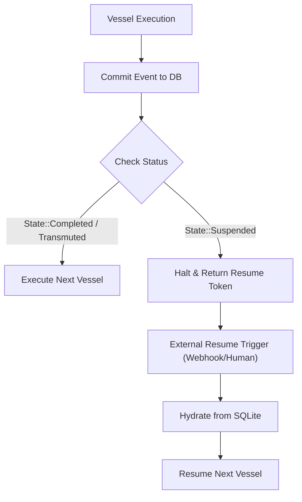

# RUBEDO: Technical Specification & Subsystem Architecture

> **Rubedo (*Redness*)**: The fourth and final stage of the alchemical *Magnum Opus*, transmuting raw base matter into gold. In this framework, chaotic, non-deterministic agent inputs and LLM streams are distilled into deterministic, verified, and durable state transitions using Rust’s compile-time safety and async runtime.

---

## 1. Alchemical Lexicon & Architectural Tenets

### 1.1 Lexicon & Conceptual Mapping

| Alchemical Term | Framework Component | Role & Responsibility |
|:---|:---|:---|
| **Rubedo** | Top-level runtime | Root framework orchestrator, builder, and execution coordinator. |
| **Artificer** | Agent (`Agent`) | Autonomous reasoning loop executing over conversation history, context, and available reagents. |
| **Reagent** | Tool (`Tool`) | Executable capability with compile-time generated JSON Schema and runtime input/output validation. |
| **Opus** | Workflow (`Workflow`) | Directed acyclic graph (DAG) of execution steps with event-sourced persistence and checkpointing. |
| **Vessel** | Step (`Step`) | Individual execution node within an Opus capable of state transformation or suspension. |
| **Crucible** | State Store (`State`) | SQLite-backed event store enabling pause, resume, rollback, and time-travel replay. |
| **Alembic** | Sandbox (`Sandbox`) | In-process, fuel-metered WASM runtime (`wasmtime`) for running untrusted or model-generated tools. |
| **Atelier** | Dev Studio (`Studio`) | Embedded Axum HTTP/SSE server + single-binary Svelte visualizer for live telemetry and checkpoint inspection. |

---

### 1.2 Core Architectural Tenets

1. **Zero Lifetime Annotations in Macros**
   Public macros (`#[reagent]`, `opus!`, `artificer!`) mandate `'static + Send + Sync` via value semantics and `Arc` envelopes. Autonomous authoring agents can generate valid code without encountering complex borrow checker lifetime issues.
2. **Deterministic Checkpointing**
   Workflows commit execution state before and after each Vessel execution. Any node can suspend execution (for human-in-the-loop approvals, webhook delays, or external signals) and resume seamlessly using an unforgeable resume token.
3. **In-Process Containment**
   Dynamic and third-party tools run inside strictly bounded `wasmtime` sandboxes with explicit memory ceilings (default: 64 MB) and instruction fuel counters (default: 100M instructions), aborting rogue execution in milliseconds without crashing the host process.
4. **Bidirectional Model Context Protocol (MCP)**
   Every native Reagent and Artificer automatically exposes an MCP server interface while the host seamlessly consumes remote MCP tool endpoints as native Reagents.
5. **Zero External Infrastructure Required**
   All core capabilities—SQLite persistence via `sqlx`, vector embeddings and storage via `fastembed-rs` and `lancedb`—execute completely in-process within a sub-40MB memory footprint, eliminating Redis, Postgres, or external vector DB dependencies for local/edge deployments.

---

## 2. Workspace & Crate Layout

```text
rubedo/
├── Cargo.toml                       # Workspace definition
├── crates/
│   ├── rubedo-core/                 # Core traits: Reagent, Artificer, Envelope, Error
│   ├── rubedo-macros/               # Proc-macros: #[reagent], opus!, artificer!
│   ├── rubedo-opus/                 # Durable DAG workflow engine
│   ├── rubedo-crucible/             # SQLite state persistence & event sourcing
│   ├── rubedo-alembic/              # Sandboxed WASM execution via Wasmtime
│   ├── rubedo-mcp/                  # Bidirectional MCP host/client implementation
│   ├── rubedo-rag/                  # In-process embeddings & vector storage
│   ├── rubedo-evals/                # Evaluator harness, assertions, and token guardrails
│   └── rubedo-atelier/              # Axum server + rust-embed Svelte dev visualizer
└── examples/
    ├── basic-artificer/             # ReAct agent with custom reagents
    ├── durable-transmutation/       # Suspended workflow with tokenized resumption
    └── sandboxed-alembic/           # Executing untrusted WASM code under fuel limits
```

### 2.1 Workspace Dependencies Specification

```toml
[workspace]
members = [
    "crates/rubedo-core",
    "crates/rubedo-macros",
    "crates/rubedo-opus",
    "crates/rubedo-crucible",
    "crates/rubedo-alembic",
    "crates/rubedo-mcp",
    "crates/rubedo-rag",
    "crates/rubedo-evals",
    "crates/rubedo-atelier",
]
resolver = "2"

[workspace.package]
version = "0.1.0"
edition = "2021"
license = "MIT OR Apache-2.0"
authors = ["Rubedo Contributors"]
repository = "https://github.com/your-org/rubedo"

[workspace.dependencies]
tokio = { version = "1.40", features = ["full"] }
serde = { version = "1.0", features = ["derive"] }
serde_json = "1.0"
schemars = { version = "0.8", features = ["derive"] }
async-trait = "0.1"
thiserror = "1.0"
tracing = "0.1"
tracing-subscriber = { version = "0.3", features = ["env-filter"] }
sqlx = { version = "0.8", features = ["runtime-tokio-rustls", "sqlite", "json"] }
wasmtime = "25.0"
wasmtime-wasi = "25.0"
axum = "0.7"
rust-embed = "8.5"
syn = { version = "2.0", features = ["full", "extra-traits"] }
quote = "1.0"
proc-macro2 = "1.0"
fastembed = "3.8"
lancedb = "0.10"
uuid = { version = "1.10", features = ["v4", "serde"] }
futures = "0.3"
```

---

## 3. Subsystem Specifications

### 3.1 `rubedo-core` (The Alchemical Primitives)

`rubedo-core` provides zero-cost trait abstractions and base error types. All structures are `'static + Send + Sync`.

#### Reagent Error Model
```rust
// crates/rubedo-core/src/reagent.rs
use async_trait::async_trait;
use serde_json::Value;

#[derive(Debug, thiserror::Error)]
pub enum ReagentError {
    #[error("Validation failed: {0}")]
    InvalidInput(String),

    #[error("Recoverable error: {message}. Guidance: {guidance}")]
    Recoverable {
        message: String,
        guidance: String,
        suggested_fix: Option<Value>,
    },

    #[error("Fatal reagent failure: {0}")]
    Fatal(String),
}
```

#### Reagent Trait Contract
```rust
#[async_trait]
pub trait Reagent: Send + Sync + 'static {
    /// Canonical unique identifier for the tool.
    fn name(&self) -> &'static str;

    /// Human/LLM-readable description of what the tool accomplishes.
    fn description(&self) -> &'static str;

    /// JSON Schema for the expected input parameters.
    fn input_schema(&self) -> Value;

    /// JSON Schema for the structured return payload.
    fn output_schema(&self) -> Value;

    /// Execute the reagent with the provided JSON arguments.
    async fn transmute(&self, input: Value) -> Result<Value, ReagentError>;
}
```

#### Artificer Definition
```rust
// crates/rubedo-core/src/artificer.rs
use std::sync::Arc;
use crate::reagent::Reagent;

pub struct Artificer {
    pub name: String,
    pub instructions: String,
    pub model: String,
    pub reagents: Vec<Arc<dyn Reagent>>,
    pub max_steps: usize,
}
```

#### Envelope & Athanor Context
- `Envelope<T>`: Value wrapper guaranteeing thread-safe, owned transfer across agent loop boundaries without reference lifetimes.
- `AthanorContext`: Stateful agent memory maintaining conversation history, token counters, tool execution journals, and cancellation tokens.

---

### 3.2 `rubedo-macros` (Macro Synthesizers)

The `#[reagent]` attribute generates JSON Schema definitions directly from Rust doc comments and function signatures, abstracting away manual serialization.

#### Syntax Example
```rust
/// Fetches the latest stock quote for a given market symbol.
#[reagent(name = "get_stock_price")]
async fn get_stock_price(
    /// Ticker symbol (e.g. AAPL, NVDA)
    symbol: String,
    /// Currency code (default: USD)
    currency: Option<String>,
) -> Result<Quote, ReagentError> {
    // Business logic
}
```

#### Generated Code Structure
1. Emits `struct GetStockPriceInput { symbol: String, currency: Option<String> }` with `#[derive(serde::Deserialize, schemars::JsonSchema)]`.
2. Emits `struct GetStockPriceReagent;`.
3. Implements `Reagent` for `GetStockPriceReagent`, mapping `transmute` directly to the async function with runtime JSON deserialization and schema validation.

---

### 3.3 `rubedo-opus` & `rubedo-crucible` (Durable DAG & Storage)

Workflows maintain durability by saving execution state before and after each node transition.



#### Vessel Trait & Status
```rust
// crates/rubedo-opus/src/vessel.rs
use async_trait::async_trait;
use serde::{Deserialize, Serialize};
use serde_json::Value;

#[derive(Clone, Debug, Serialize, Deserialize)]
pub enum VesselStatus {
    Pending,
    Active,
    Suspended { resume_token: String },
    Transmuted { output: Value },
    Corrupted { error: String },
}

#[async_trait]
pub trait Vessel: Send + Sync + 'static {
    fn id(&self) -> &'static str;
    async fn distill(&self, ctx: &mut OpusContext) -> Result<VesselStatus, VesselError>;
}
```

#### Database Schema (`rubedo-crucible/migrations/01_init.sql`)
```sql
CREATE TABLE IF NOT EXISTS opus_runs (
    run_id TEXT PRIMARY KEY,
    opus_name TEXT NOT NULL,
    status TEXT NOT NULL,
    current_state TEXT NOT NULL, -- JSON
    created_at DATETIME DEFAULT CURRENT_TIMESTAMP,
    updated_at DATETIME DEFAULT CURRENT_TIMESTAMP
);

CREATE TABLE IF NOT EXISTS vessel_events (
    event_id INTEGER PRIMARY KEY AUTOINCREMENT,
    run_id TEXT NOT NULL,
    vessel_id TEXT NOT NULL,
    status TEXT NOT NULL,
    payload TEXT, -- JSON
    recorded_at DATETIME DEFAULT CURRENT_TIMESTAMP,
    FOREIGN KEY(run_id) REFERENCES opus_runs(run_id)
);

CREATE TABLE IF NOT EXISTS suspended_tokens (
    token TEXT PRIMARY KEY,
    run_id TEXT NOT NULL,
    vessel_id TEXT NOT NULL,
    created_at DATETIME DEFAULT CURRENT_TIMESTAMP,
    FOREIGN KEY(run_id) REFERENCES opus_runs(run_id)
);
```

---

### 3.4 `rubedo-alembic` (WASM Sandboxed Isolation)

Untrusted or model-generated tools are compiled to WASM and executed with strict capability and instruction constraints:

```rust
// crates/rubedo-alembic/src/lib.rs
use wasmtime::*;
use wasmtime_wasi::sync::WasiCtxBuilder;

pub struct AlembicConfig {
    pub max_memory_bytes: usize, // e.g., 64 * 1024 * 1024 (64MB)
    pub fuel_limit: u64,         // e.g., 100_000_000 instructions
}

pub struct AlembicSandbox {
    engine: Engine,
    config: AlembicConfig,
}

impl AlembicSandbox {
    pub fn new(config: AlembicConfig) -> Result<Self, anyhow::Error> {
        let mut wasm_config = Config::new();
        wasm_config.consume_fuel(true);
        let engine = Engine::new(&wasm_config)?;
        Ok(Self { engine, config })
    }

    pub async fn execute_reagent(
        &self,
        wasm_binary: &[u8],
        input: serde_json::Value,
    ) -> Result<serde_json::Value, anyhow::Error> {
        let mut store = Store::new(&self.engine, ());
        store.set_fuel(self.config.fuel_limit)?;
        // Linear memory initialization & zero-access WASI configuration
        // Execute entrypoint and parse output JSON
        todo!()
    }
}
```

---

### 3.5 `rubedo-mcp` (Bidirectional Model Context Protocol)

Provides both Client and Server capabilities following the Model Context Protocol specification:
- **`McpClient`**: Discovers tools over stdio/SSE transports using `tools/list` and exposes them dynamically as `Arc<dyn Reagent>`.
- **`McpServer`**: Exposes all registered `Reagent` and `Artificer` instances over stdio or SSE endpoints, receiving `tools/call` JSON-RPC requests and returning structured payloads.

---

### 3.6 `rubedo-rag` (Spagyric In-Process Vector Store)

- In-process semantic chunking and recursive text splitting.
- `fastembed-rs` integration using `BGESmallENV15` embedding model.
- Embedded `LanceDB` storage without external daemon dependencies.
- Exposes `SpagyricIndex` with `add_documents` and `search` methods.
- Dynamic `SearchReagent` automatically generated for any Artificer requiring contextual knowledge retrieval.

---

### 3.7 `rubedo-atelier` (Embedded Visualizer)

- **Single Binary Distribution**: Frontend UI assets built with Svelte/Vite embedded directly into the Rust binary using `rust-embed`.
- **Real-Time Telemetry**: Broadcasts step transitions, token usage, and latency metrics over Server-Sent Events (SSE).
- **Checkpoint Inspector**: Inspects input/output payloads of historical Vessel runs and triggers workflow resumptions with modified payloads.
- **HTTP Endpoints**:
  - `GET /api/registry`: Returns JSON representation of all registered Artificers, Opuses, and Reagents.
  - `GET /api/events`: SSE endpoint streaming live execution traces.
  - `POST /api/opus/:run_id/resume`: Endpoint for triggering resumes on suspended tokens.
  - `GET /*`: Serves pre-built frontend assets from memory.

---

### 3.8 `rubedo-evals` (Verification Harness & Guardrails)

- Deterministic scoring: `ExactMatch`, `LevenshteinDistance`, `JsonGrammarValidator`.
- Model-graded scoring: `LlmJudge` for evaluating semantic criteria (factual correctness, toxicity, tone).
- `#[artificer_test]` procedural macro: runs an Artificer against $N$ benchmark test cases and outputs aggregate pass/fail metrics with token consumption budgets.
