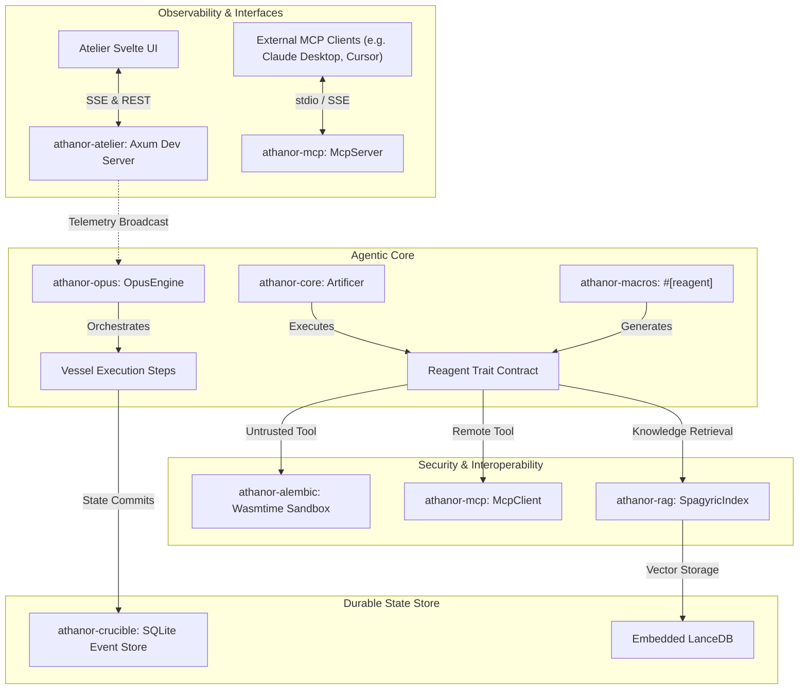
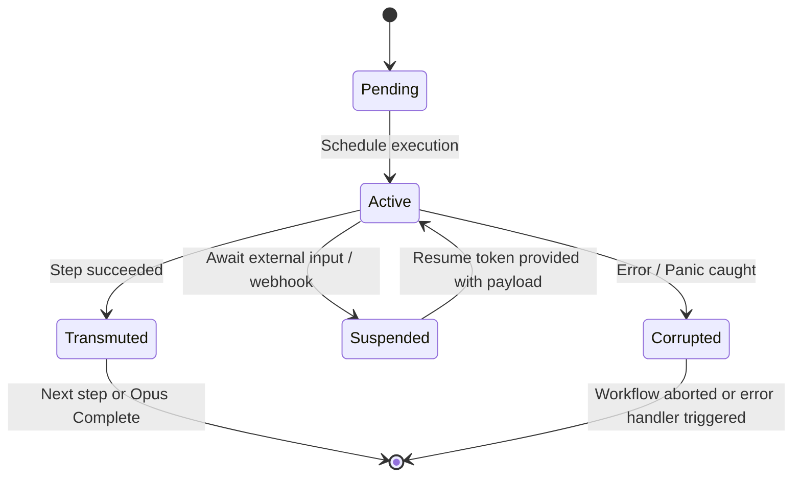
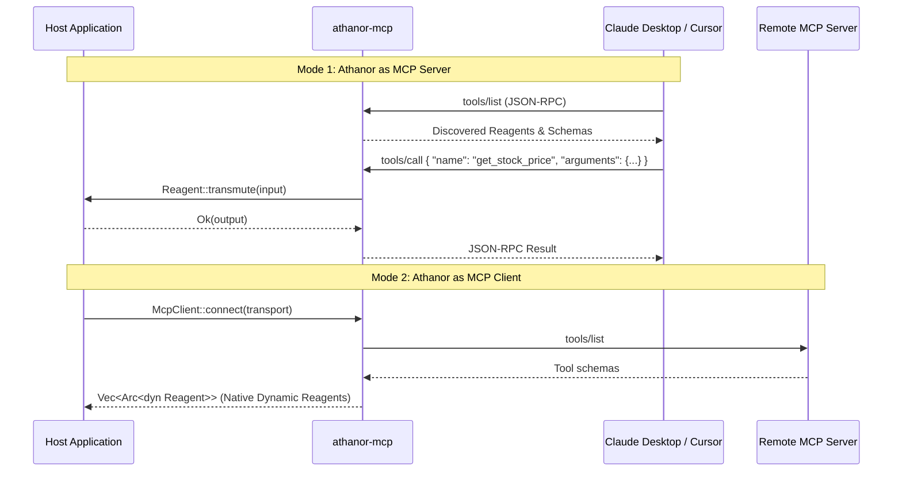

# ATHANOR: Subsystem Architecture & Design Patterns

## Architectural Overview

Athanor is structured as a modular, high-cohesion Rust workspace. The core philosophy centers on **alchemical transmutation**: converting chaotic, non-deterministic model completions and tool interactions into deterministic, verifiable, durable state transitions.



---

## 1. The "Zero Lifetime Annotations" Pattern

### Problem
In conventional Rust development, asynchronous agent workflows and dynamic tool registries frequently run into complex borrow checker lifetime errors (`'a`, `'static`, non-owned references across `async` boundaries). For autonomous code-generation agents (such as LLMs writing tools at runtime), managing lifetimes in procedural macros causes frequent compile-time failures.

### Solution
Athanor eliminates all lifetime parameters from public traits and macros:
- **Owned Value Semantics**: Tool inputs and outputs pass as owned `serde_json::Value` or owned deserialized structs.
- **Envelope Wrapping**: Internal state transitions are wrapped in `Arc` envelopes.
- **Universal `'static + Send + Sync`**: Every `Reagent` and `Vessel` implementation satisfies `'static + Send + Sync`.

```rust
// No lifetime parameters on trait definitions or invocations
#[async_trait]
pub trait Reagent: Send + Sync + 'static {
    fn name(&self) -> &'static str;
    fn description(&self) -> &'static str;
    fn input_schema(&self) -> Value;
    fn output_schema(&self) -> Value;
    async fn transmute(&self, input: Value) -> Result<Value, ReagentError>;
}
```

---

## 2. Event-Sourced Workflow Engine (Opus & Crucible)

Workflows in Athanor are represented as directed acyclic graphs (DAGs) of execution steps termed **Vessels**.

### 2.1 Vessel Lifecycle State Machine



### 2.2 Deterministic Checkpointing

Before and after every Vessel execution, state transitions are recorded into `athanor-crucible` via SQLite event sourcing:
1. **Pre-execution checkpoint**: Records the incoming state snapshot and changes status to `Active`.
2. **Post-execution checkpoint**:
   - If output is `Transmuted`, writes the output payload into `vessel_events` and marks state `Completed`.
   - If output is `Suspended`, generates a cryptographic UUIDv4 resume token, registers it in `suspended_tokens`, commits the snapshot, and halts execution cleanly.
3. **Resumption**: When `OpusEngine::resume(run_id, token, payload)` is invoked, `CrucibleEngine` validates the token, hydrates the current state from SQLite, feeds the resume payload into the awaiting Vessel, and continues the DAG.

---

## 3. In-Process Sandboxing (Alembic)

Untrusted or model-generated tools cannot be permitted direct host access. Instead of spawning heavy Docker containers, `athanor-alembic` embeds WebAssembly execution via `wasmtime`:

- **Linear Memory Envelopes**: Guest WASM modules are constrained to a configurable memory ceiling (default: 64 MB).
- **Instruction Fuel Metering**: Every execution is assigned a fixed fuel allocation (default: 100,000,000 instructions). Infinite loops consume fuel and abort deterministically within $<15$ milliseconds.
- **Zero-Access WASI**: Default WASI capabilities exclude filesystem access, network sockets, and environment variables. Host-guest communication occurs strictly through linear memory JSON serialization.

---

## 4. Universal Interoperability (Bidirectional MCP)

Athanor provides bidirectional Model Context Protocol (MCP) support:



---

## 5. Spagyric Embedded RAG

`athanor-rag` eliminates external vector database infrastructure:
- **Local Embeddings**: Runs `fastembed-rs` (model: `BGESmallENV15`) directly in-process using ONNX Runtime.
- **Embedded Vector Storage**: Uses `LanceDB` in local embedded file mode.
- **Semantic Chunking**: Automatically splits technical text using recursive delimiter boundaries while preserving markdown semantics.
- **Sub-40MB Footprint**: Memory usage remains within strict edge/embedded constraints.

---

## 6. Atelier Dev Studio & Observability Architecture

`athanor-atelier` compiles an Axum web server and pre-built Svelte/Vite UI into the host application binary:
- **Rust-Embed**: Static assets are bundled directly into the executable binary via `rust-embed`.
- **Live SSE Streaming**: A custom `tracing_subscriber::Layer` captures structured workflow events and broadcasts them across a `tokio::sync::broadcast` channel to active browser clients.
- **Time-Travel Inspector**: Developers can inspect the historical input and output payloads of each Vessel step, edit payloads, and re-trigger runs directly from the UI.
